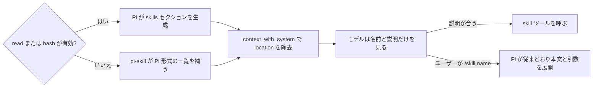

# pi-skill

Pi のスキルを `skill` ツールで読み出す Pi 拡張です。Pi はスキル一覧（名前・説明・SKILL.md の絶対パス）をシステムプロンプトに常時載せ、モデルに `read` で SKILL.md を読ませます。pi-skill は、`skill` ツールが有効で、モデル向けスキルが1件以上あり、skills セクションの全エントリを解析できたリクエストに限り、一覧から `<location>` を外して読み出しを `skill` ツールに置き換えます。それ以外は Pi 既定のプロンプトを変更しません。

Pi が skills セクションを生成するのは `read` か `bash` が有効なときだけです。どちらも無効なときは、pi-skill が同じ形式で一覧を用意します。

| 課題 | pi-skill の挙動 |
|---|---|
| パスが毎リクエストのコンテキストを消費する | `<location>` をリクエストから外し、ツール結果でのみ渡す |
| モデルが `read` の limit などで本文を読み切らないことがある | ツールが frontmatter と本文の前後空白を除いた本文を1回で返す |



モデルが見る一覧は次のように変わります。

```text
Pi 既定                                      pi-skill
--------------------------------------------  --------------------------------------------
<skills>                                      <skills>
The following skills provide specialized ...  The following skills provide specialized ...
Use the read tool to load a skill's file ...  Use the skill tool to load a skill's full ...
When a skill file references a relative ...   The skill tool reports the skill directory; ...
                                              <available_skills>
<available_skills>                              <skill>
  <skill>                                         <name>pdf-tools</name>
    <name>pdf-tools</name>                        <description>...</description>
    <description>...</description>              </skill>
    <location>/home/me/.agents/.../SKILL.md</location>
  </skill>
</available_skills>                           </available_skills>
</skills>                                      </skills>
```

`skill` ツールの結果は Pi 本体の `/skill:name` の展開と同一形式で、frontmatter と本文の前後空白を除いた本文を含みます。基準ディレクトリは読み出し時にだけ渡します。

```text
<skill name="pdf-tools" location="/home/me/.agents/skills/pdf-tools/SKILL.md">
References are relative to /home/me/.agents/skills/pdf-tools.

# PDF tools
...
</skill>
```

## 動作要件

- Pi 1.0 以上（1.0.3 で動作確認。1.0.0〜1.0.2 は未検証）
- Node.js 22.19 以上（Pi 本体と同じ）

## インストール

```bash
pi install git:github.com/kurowashi/pi-skill
```

ref を固定する場合は `pi install git:github.com/kurowashi/pi-skill@<tag|commit>`。

ローカルの作業コピーを使う場合:

```bash
pi install /path/to/pi-skill
```

または直接読み込み:

```bash
pi --extension /path/to/pi-skill/src/index.ts
```

## 使い方

設定はありません。`skill` ツールが有効で、モデル向けスキルが1件以上あり、skills セクションの全エントリを解析できたとき、次のリクエストから一覧に `<location>` を含めず、モデルは `skill` ツールでスキルを読み出します。条件を満たさないときは Pi 既定のプロンプトを変更しません。

```
モデル: skill({ name: "pdf-tools" })
```

`/skill:name` は Pi 本体の機能のままで、pi-skill は介入しません。`/skill:pdf-tools extract report.pdf` は従来どおり frontmatter と本文の前後空白を除いた本文と引数を user メッセージとして展開します。

## 挙動

| 条件 | 挙動 |
|---|---|
| pi-switch などがスキルを無効化した | 一覧から消え、`skill` ツールでも読めない |
| `disable-model-invocation: true` のスキル | 一覧に載らないため `skill` ツールでも読めない。`/skill:name` でだけ使える |
| `skill` が有効で `read` / `bash` が無効、可視スキルが1件以上 | pi-skill が Pi と同じ形式の一覧を補う |
| `skill` が無効で `read` または `bash` が有効 | 一覧の書き換えをやめ、Pi 既定に戻す |
| `skill`・`read`・`bash` がすべて無効 | 一覧は生成されない |
| スキルが0件、または一部のスキルしか解析できない | 何も変更しない |
| 一覧にない名前を指定した | エラーと利用可能なスキル名の一覧を返す |
| 利用可能なスキルが無い状態で呼び出した | その旨のエラーを返す |
| SKILL.md が読めない | ツールがエラーを返し、セッションは止まらない |
| 別拡張が `forceSystemPrompt` でプロンプトを差し替えている | skills セクションが無いため何もしない（Pi の仕様） |
| セッションの保存内容 | 変更しない。compaction・resume・`/reload` の影響なし |

> `read` と `bash` が無効なときの一覧は `before_agent_start` 時点のスキル一覧から作ります。pi-skill より後に `options.skills` をフィルタする拡張の結果は反映されないため、pi-switch を使う場合は pi-switch を先に読み込んでください。

## 開発

```bash
npm install
npm run verify
```

`verify` は `biome check`、`tsc --noEmit`、`knip`、`node --test`、カバレッジしきい値をまとめて実行します。設計の判断基準は [DESIGN.md](DESIGN.md)、変更時の制約は [AGENTS.md](AGENTS.md) にあります。

## ライセンス

[MIT](LICENSE)
